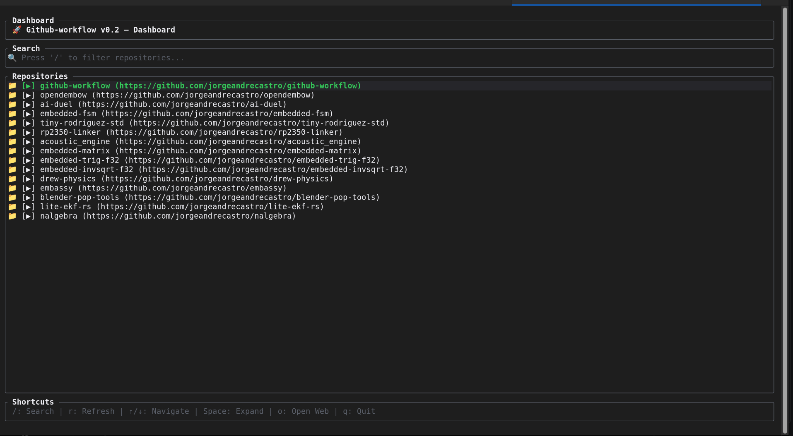
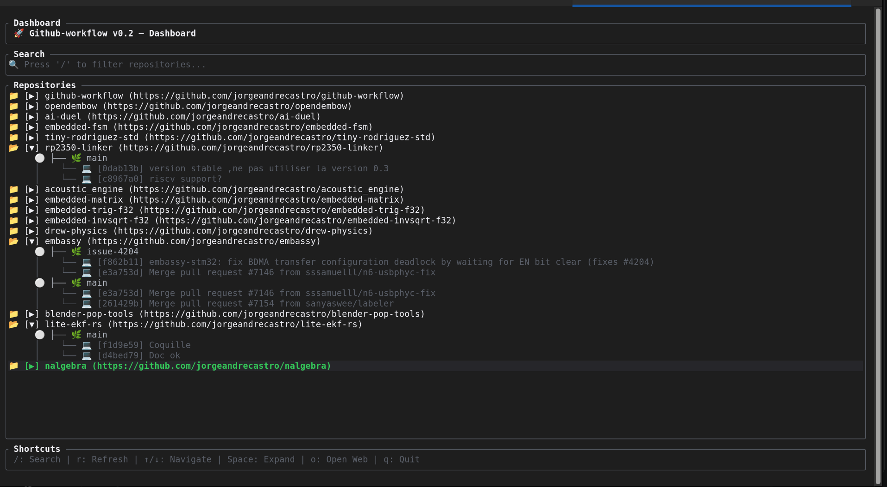

<div align="center">

# github-workflow 🚀

**Browse your GitHub repositories, branches, pull requests, and CI/CD statuses right from your terminal.**

[](https://www.rust-lang.org/)
[](https://ratatui.rs/)
[](https://opensource.org/licenses/MIT)

<br>

<br>


</div>

---

## Why github-workflow?

Switching between your terminal, browser, and GitHub just to check a pull request or CI run can interrupt your flow. **github-workflow** is a fast, asynchronous terminal UI that brings your GitHub activity into one place without leaving the command line.

## Features

| | |
| --- | --- |
| ⚡ **Responsive interface** | Rust-powered background workers keep the UI responsive during API calls. |
| 📂 **On-demand loading** | Repositories load first; branches, commits, and pull requests are fetched as you explore. |
| 🔄 **On-the-fly refresh** | Press `r` to asynchronously reload data for any selected repository. |
| 🔎 **Live filtering** | Press `/` to filter repositories by name in real time. |
| ✅ **CI/CD status** | Real-time status indicators (success, failure, in-progress) alongside branches. |
| 🔀 **Pull request overview** | See open pull requests associated with your branches. |
| 🌐 **Open in browser** | Press `o` on a repository, branch, pull request, or commit to open it on GitHub. |

## Getting started

### Prerequisites

- [Rust toolchain](https://www.rust-lang.org/tools/install)
- A GitHub Personal Access Token (PAT) with required repository read access

### Install and run

1. Clone the repository:

   ```bash
   git clone https://github.com/jorgeandrecastro/github-workflow.git
   cd github-workflow
   ```

2. Set your GitHub token:

   ```bash
   export GITHUB_TOKEN="your_personal_access_token_here"
   ```

3. Build and launch the app:

   ```bash
   cargo run --release
   ```

## Download & Run (No Rust required)

If you don't have Rust installed and just want to test the binary directly:

1. Go to the [Releases page](https://github.com/jorgeandrecastro/github-workflow/releases) and download the binary for your operating system (`linux`, `macos`, or `windows`).

2. Make the binary executable (Linux/macOS):

   ```bash
   chmod +x github-workflow-linux
   ```

3. Set your GitHub token:

   ```bash
   export GITHUB_TOKEN="your_personal_access_token_here"
   ```

4. Run the app:

   ```bash
   ./github-workflow-linux
   ```

## Keyboard shortcuts

| Key | Action |
| --- | --- |
| `↑` / `↓` | Navigate repositories, branches, pull requests, and commits |
| `Space` / `Enter` | Expand or collapse the repository tree |
| `/` | Filter repositories by name |
| `r` | Refresh the selected repository asynchronously |
| `o` | Open the selected item in your browser |
| `q` / `Esc` | Quit the application |

## Tech stack

| Component | Technology |
| --- | --- |
| Language | Rust |
| TUI framework | [Ratatui](https://ratatui.rs/) and Crossterm |
| API client | Reqwest and Serde |
| Browser integration | Open |

## Contributing

Contributions, issues, and feature requests are welcome. Feel free to check out the [open issues](https://github.com/jorgeandrecastro/github-workflow/issues).

## License

Distributed under the MIT License.
